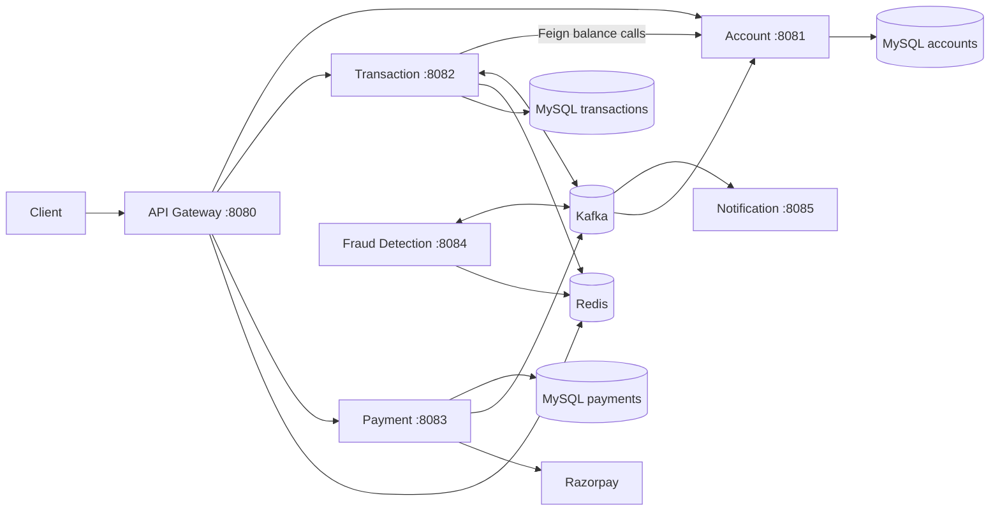

<div align="center">

# Digital Banking System

**A Spring Boot microservices application for accounts, transfers, fraud checks, and payments.**

[](https://www.java.com/)
[](https://spring.io/projects/spring-boot)
[](LICENSE)

</div>

> **Deployment status:** AWS EC2 deployment configuration has been set up (NCR). There is currently no public live URL. The application can be run locally with Docker Compose.

## Contents

- [At a glance](#at-a-glance)
- [Architecture & request flow](#architecture--request-flow)
- [Services & project structure](#services--project-structure)
- [Technology](#technology)
- [Run locally with Docker](#run-locally-with-docker)
- [Configuration](#configuration)
- [API reference](#api-reference)
- [Data & messaging](#data--messaging)
- [Health & tests](#health--tests)
- [Troubleshooting & limitations](#troubleshooting--limitations)
- [Future improvements](#future-improvements)
- [License & security](#license--security)

## At a glance

| | |
|---|---|
| **Purpose** | Account management, internal transfers, fraud checks, and Razorpay order creation |
| **Local gateway** | `http://localhost:8080` |
| **API base path** | `/api/v1` |
| **Services** | API Gateway, Account, Transaction, Payment, Fraud Detection, Notification |
| **Local infrastructure** | MySQL, Kafka/Zookeeper, Redis via Docker Compose |

### Features

| Capability | What it does |
|---|---|
| **Accounts** | Create and query accounts, view balances, and block accounts |
| **Transfers** | Initiate transfers, view history, and verify with OTP |
| **Fraud checks** | Check transaction velocity, unusual amounts, and balance thresholds |
| **Payments** | Create Razorpay payment orders |
| **Events** | Coordinate workflows over Kafka; log notifications |
| **Gateway** | Route APIs and apply Redis-backed IP rate limits |

## Architecture & request flow



### Transfer workflow

1. Gateway forwards the transfer request to Transaction Service and applies its route rate limit.
2. Transaction Service synchronously deducts the sender balance through Account Service, stores a `PROCESSING` transaction, and publishes `transaction.initiated`.
3. Fraud Detection checks the transaction and publishes either `fraud.check.clean` or `verification.required`.
4. A clean transaction is marked `COMPLETED`; `transaction.completed` causes Account Service to credit the receiver.
5. A suspicious transaction requires OTP verification. The OTP is stored in Redis for five minutes. A valid OTP completes the transfer; an expired or incorrect OTP causes a sender refund. An incorrect OTP also triggers an account block event.
6. Notification Service consumes events and writes notification content to application logs.

The flow is asynchronous after transfer initiation and uses compensating actions rather than a distributed database transaction. A newly created transfer can initially return with status `PROCESSING`.

## Services & project structure

| Directory | Role | Port |
|---|---|---:|
| `api-gateway/` | Routes account, transaction, and payment APIs; applies rate limits | 8080 |
| `account-service/` | Account records and balance operations | 8081 |
| `transaction-service/` | Transfers, transaction history, and OTP workflow | 8082 |
| `payment-service/` | Razorpay order creation and payment records | 8083 |
| `fraud-detection-service/` | Kafka-driven transaction checks | 8084 |
| `notification-service/` | Kafka consumers that log notifications | 8085 |
| `docker-compose.yml` | Local infrastructure and all six application services | — |
| `frontend/` | Local frontend work; currently excluded from GitHub by `.gitignore` | 3000 |

Each service is an independent Maven project with `src/main/java`, `src/main/resources`, and `src/test/java`. Packages contain the service's controllers, services, repositories, entities, DTOs, clients, events, or configuration as needed.

## Technology

| Area | Stack |
|---|---|
| Language/runtime | Java 17 |
| Frameworks | Spring Boot 4.1.2, Spring Cloud 2025.1.4, Spring MVC, Spring Cloud Gateway |
| Persistence | Spring Data JPA, MySQL 8.0 |
| Messaging/cache | Apache Kafka with Zookeeper, Redis |
| Integrations | OpenFeign, Razorpay Java SDK 1.4.9 |
| Build/test | Maven Wrapper, JUnit / Spring Boot test dependencies |
| Local infrastructure | Docker Compose |

## Run locally with Docker

### Prerequisites

- Docker Engine and Docker Compose

From the repository root, build the six microservice images locally and start the full backend:

```bash
docker compose up --build -d
docker compose ps
```

Compose builds the six application images from their service source and Dockerfiles; it does not pull those application images from AWS ECR. Docker downloads the infrastructure images (MySQL, Redis, Kafka, and Zookeeper) from their registries if they are not already present locally.

The API Gateway is available at `http://localhost:8080`. Service ports are `8081`–`8085`; MySQL is exposed on `localhost:3307`, Redis on `localhost:6379`, and Kafka on `localhost:9092`. Within the Compose network, applications connect to infrastructure using service hostnames such as `mysql`, `redis`, and `kafka`.

After changing service code, rebuild and restart the services:

```bash
docker compose up --build -d
```

View logs and stop the stack with:

```bash
docker compose logs -f api-gateway
docker compose down
```

`docker compose down` preserves the MySQL data volume. To remove the data volume as well, use `docker compose down -v`.

> **Fresh-clone configuration note:** Service `application.yaml` files are currently excluded by `.gitignore` and may exist only in the local working copy. They are required in each service's `src/main/resources` directory when building its image. A fresh clone needs these local configuration files before `docker compose up --build -d` can start the services. Do not commit credentials; use environment variables or sanitized configuration values.

The `frontend/` directory is local-only and is not included in this repository at this time. To run it locally, use `npm install` and `npm run dev` from that directory; it is configured to connect to the gateway at `http://localhost:8080`.

## Configuration

Spring Boot properties can be overridden with environment variables or command-line options. Docker Compose reads a root `.env` file when present; keep it local and never commit credentials.

| Configuration | Defaults / notes |
|---|---|
| Ports | Gateway `8080`; services `8081`–`8085` as listed above |
| MySQL | Local host port `3307`; separate databases `dbs_account_db`, `dbs_transaction_db`, `dbs_payment_db` |
| Redis | `localhost:6379`; Gateway supports `REDIS_HOST` |
| Account service URL | `ACCOUNT_SERVICE_URL`, default `http://localhost:8081` |
| Gateway backend URLs | `TRANSACTION_SERVICE_URL` defaults to `http://localhost:8082`; `PAYMENT_SERVICE_URL` defaults to `http://localhost:8083` |
| Fraud thresholds | `fraud.max-transactions-per-minute: 5`; `fraud.suspicious-amount-multiplier: 5`; `fraud.max-balance-percentage: 0.90` |
| Razorpay | Set `RAZORPAY_KEY_ID` and `RAZORPAY_KEY_SECRET` for payment requests; keep credentials in local environment configuration |

For local MySQL overrides, standard Spring properties include `SPRING_DATASOURCE_URL`, `SPRING_DATASOURCE_USERNAME`, and `SPRING_DATASOURCE_PASSWORD`. Razorpay key properties can be overridden with `RAZORPAY_KEY_ID` and `RAZORPAY_KEY_SECRET`. Never commit real credentials.

## API reference

The Gateway routes the API paths below. Use `http://localhost:8080` as the base URL for local requests. Requests/responses use JSON unless indicated.

| Method | Path | Purpose and input |
|---|---|---|
| `POST` | `/api/v1/accounts` | Create account. JSON fields: `accountHolderName`, `email`, `phone`, `accountType` (`SAVING`, `CURRENT`, `FIXED_DEPOSIT`), `initialDeposit`. |
| `GET` | `/api/v1/accounts/{accountNumber}` | Get account details. |
| `GET` | `/api/v1/accounts/{accountNumber}/balance` | Get balance. |
| `PUT` | `/api/v1/accounts/{accountNumber}/block` | Block account. |
| `PUT` | `/api/v1/accounts/{accountNumber}/deduct?amount={amount}` | Deduct balance; used by transaction workflow. |
| `PUT` | `/api/v1/accounts/{accountNumber}/credit?amount={amount}` | Credit balance; used by transaction workflow. |
| `POST` | `/api/v1/transactions/transfer` | Start transfer. JSON: `senderAccountNumber`, `receiverAccountNumber`, positive `amount`, optional `description`. |
| `GET` | `/api/v1/transactions/{transactionId}` | Get transaction and current status. |
| `GET` | `/api/v1/transactions/account/{accountNumber}` | List transactions sent from this account, newest first. |
| `POST` | `/api/v1/transactions/{transactionId}/verify?otp={otp}` | Verify a pending transaction with its six-digit OTP. |
| `POST` | `/api/v1/payments/create-order` | Create a Razorpay order. JSON: `accountNumber`, positive `amount`, optional `description`. |

### Example: create an account

```bash
curl -X POST http://localhost:8080/api/v1/accounts \
  -H 'Content-Type: application/json' \
  -d '{"accountHolderName":"Alex Example","email":"alex@example.test","phone":"5550100","accountType":"SAVING","initialDeposit":1000.00}'
```

The response includes the generated `accountNumber`, account status, balance, and daily transaction limit.

### Example: initiate a transfer

```bash
curl -X POST http://localhost:8080/api/v1/transactions/transfer \
  -H 'Content-Type: application/json' \
  -d '{"senderAccountNumber":"<sender>","receiverAccountNumber":"<receiver>","amount":25.00,"description":"Example transfer"}'
```

The response includes a transaction `id`, `referenceNumber`, and initial status. Query `GET /api/v1/transactions/{transactionId}` to check its later status.

## Data & messaging

### MySQL entities

| Table | Stored fields (overview) |
|---|---|
| `accounts` | Account number, holder contact details, account type/status, balance, daily limit, timestamps |
| `transactions` | Sender/receiver numbers, amount, type/status, description, failure reason, reference, timestamps |
| `payments` | Account number, amount/currency/status, Razorpay IDs, description, failure reason, timestamps |

The account and transaction services configure Hibernate `ddl-auto: update`. No database migration files are included.

### Kafka and Redis

Kafka topics used by service code: `transaction.initiated`, `fraud.check.clean`, `verification.required`, `transaction.otp.generated`, `transaction.completed`, `transaction.refunded`, `fraud.detected`, `payment.completed`, and `payment.failed`. Local Compose enables automatic topic creation.

Redis holds Gateway rate-limit state, fraud velocity and average-amount values, and OTPs with a five-minute expiry. No dead-letter queue or schema registry is configured.

## Health & tests

Actuator health and info endpoints are configured across services; the Gateway additionally exposes gateway actuator data:

```bash
curl http://localhost:8080/actuator/health
curl http://localhost:8081/actuator/health
curl http://localhost:8082/actuator/health
curl http://localhost:8083/actuator/health
curl http://localhost:8084/actuator/health
curl http://localhost:8085/actuator/health
```

Run a module's tests from its directory:

```bash
./mvnw test
```

On Windows use `.\mvnw.cmd test`. The modules include Spring application context-load tests; some require their configured infrastructure (such as MySQL) to be available.

## Troubleshooting & limitations

| Symptom | Check |
|---|---|
| MySQL, Kafka, or Redis connection refused | Run `docker compose ps`; inspect container logs and ports `3307`, `9092`, `6379`. |
| Database authentication/connection error | Compare the service JDBC configuration with the local MySQL setup. The Compose MySQL volume persists across restarts. |
| Gateway returns `503` | Verify target services and Redis. Gateway rate limits are 10 requests/second (burst 20) for account/transaction routes and 5/second (burst 10) for payment routes, by remote IP. |
| Transfer stays `PROCESSING` | Check Kafka consumer logs and query the transaction again. Suspicious transactions require OTP verification. |
| Payment provider calls fail | Supply valid Razorpay test credentials through local environment variables. |

**Implementation caveats**

- Local Compose is a development setup: single-node Kafka and MySQL root access; it is not production-hardened.
- The Gateway has no authentication configured. Do not expose account/balance operations to untrusted users.
- Notification consumers write message content to application logs. Email delivery is not implemented despite mail dependencies.
- Payment webhook handler has no HTTP route annotation, and the configured webhook secret is not validated.
- Payment creation requests `USD` but converts the amount to minor units by multiplying by 100. Verify currency/amount handling before real use.
- Daily transaction limits are stored but are not enforced by transfer logic.
- OTPs are included in application notification logs. Do not use real financial or personal data in development.

## Future improvements

- Add authentication/authorization, safer service-to-service access, and production deployment hardening.
- Move secrets to a managed secret store and standardize service configuration.
- Add database migrations, event idempotency, retries/dead-letter handling, and saga recovery.
- Implement and secure a mapped Razorpay webhook with signature verification.
- Add end-to-end integration tests for transfer, fraud, payment, and notification flows.

## License & security

This project is licensed under the [MIT License](LICENSE). The license does not grant rights to third-party services, credentials, or infrastructure. The application is a development project, not a certified banking platform; review the security model and payment behavior before public or financial use.
